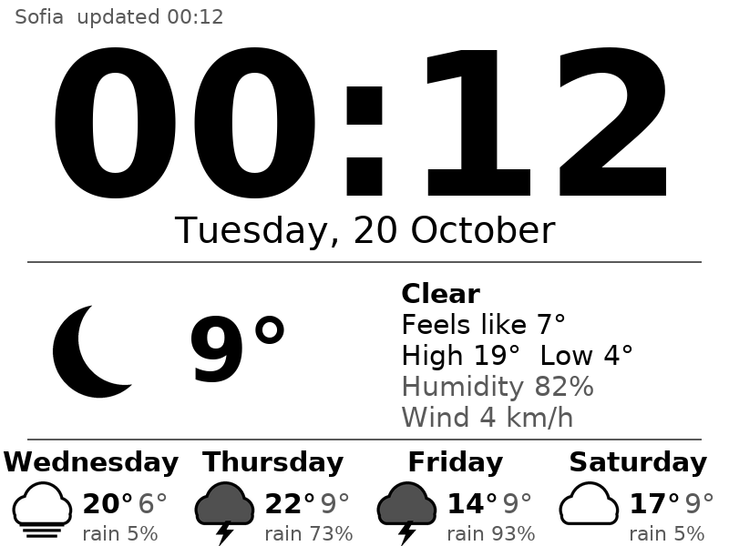

# nookclock: Nook Simple Touch clock + weather display

Turns a rooted Nook Simple Touch (NST, Android 2.1, 600×800 e-ink) into a
wall clock with current weather and a 4-day forecast.



## How it works

```
 Open-Meteo (plain HTTP, no key) ──► nookclock (static ARM binary on the Nook)
                                         │  own DNS client (no resolv.conf on Android 2.1)
                                         │  fonts + icons baked in (no libs)
                                         ▼
                              /dev/graphics/fb0  ──► e-ink
                              zero-length write = quick update
                              /sys/class/graphics/fb0/epd_refresh = full flash refresh
```

* **One static binary** (musl, ARMv7, soft-float, non-PIE, ~1.5 MB). It needs
  nothing from Android, so the old bionic libc and 2.6.29 kernel don't matter.
* **The Android UI is stopped** (`stop` = kill zygote) so nothing paints over
  the clock. A kernel wakelock keeps the CPU and Wi-Fi awake.
  `nookclock.sh stop`, or a reboot, brings the B&N UI back. Nothing is
  installed into `/system`, so a reboot always returns the Nook to stock.
* **Refresh policy:** a quick non-flashing update every minute and a full
  flashing refresh every `full_every` minutes (default 30) to clear ghosting.
  Pressing a page-turn button forces a full refresh and a weather update.
* **Weather:** fetched every 15 min. On failure it retries every 2 min, and
  after 3 h without data it shows "stale". Local time and DST come from
  Open-Meteo's `utc_offset_seconds`, so no timezone database is needed.
* **Clock drift:** with the B&N UI stopped nothing syncs the clock, so it is
  corrected from the weather server's HTTP `Date` header (`sync_time = 1`).
* **Plain HTTP only:** the NST's TLS stack can't talk to modern servers,
  which is why Open-Meteo is used over `http://`.

## Layout

| path | what |
|---|---|
| `src/nookclock.c` | the whole program: config, rendering, fb output, DNS/HTTP, JSON, main loop |
| `tools/genassets.py` | rasterises DejaVu fonts + draws weather icons into `src/assets.h` |
| `device/nookclock.sh` | on-device control script (`start`/`stop`/`restart`/`status`/`probe`) |
| `device/nookclock.conf` | location, units, rotation, refresh intervals |
| `deploy.sh` | push over ADB-over-Wi-Fi and restart |
| `test/sample.json` | saved Open-Meteo response for offline previews |

## Build

```sh
# toolchain (already downloaded into ./toolchain):
#   curl -O https://musl.cc/arm-linux-musleabi-cross.tgz && tar xzf ... -C toolchain
make            # build/nookclock (ARM) + build/nookclock-host (PC preview)
make preview    # build/landscape.pgm + build/portrait.pgm from test/sample.json
build/nookclock-host -c device/nookclock.conf --preview out.pgm   # live data
```

Needs `python3-pil` (system `/usr/bin/python3`; override with `make PYTHON=...`).

## Deploy

1. Edit `device/nookclock.conf`: set `lat`, `lon`, `place` and `rotate`.
2. On the Nook, make sure Wi-Fi is on and ADB over Wi-Fi is enabled (port 5555).
3. Run:
   ```sh
   sudo apt install adb
   ./deploy.sh <nook-ip> probe     # first time: check what the device looks like
   ./deploy.sh <nook-ip>           # push + start
   ./deploy.sh <nook-ip> status    # running? + log
   ./deploy.sh <nook-ip> stop      # back to the B&N UI
   ```

## Verified so far / to verify on the device

Verified on the PC:

* The ARM binary runs under qemu (`-cpu cortex-a8`, uname 2.6.29). It fetches
  live weather and renders the same image as the host build.
* Custom DNS, HTTP, JSON parsing and both orientations work.

Can only be checked on the real Nook (each one has a fallback):

| risk | check | fallback |
|---|---|---|
| framebuffer format / yoffset | log line `fb 600x800 16bpp ...` | code handles 8/16/32 bpp and yoffset |
| quick update not triggered by the zero-length write | clock doesn't change until a full refresh | set `full_every = 1` |
| Wi-Fi drops after `stop` (system_server gone) | log shows `DNS lookup ... failed` | start with `KEEP_UI=1`, or restart wpa_supplicant/dhcpcd manually |
| `adb shell` not root | `probe` → `id` | run `su -c "sh .../nookclock.sh start"` |
| battery path | top-right shows `%` | it's skipped silently if missing |

## Possible next steps

* Autostart at boot (hook into `init.rc` / `install-recovery.sh`). Do this
  only after it has run stable for a few days.
* Nightly deep-refresh / dim schedule, indoor sensor, Cyrillic day names
  (add the glyphs to `ASCII` in `genassets.py`).

## References

* [badd10de: Nook Simple Touch notes](https://badd10de.dev/notes/nook-simple-touch.html):
  fb0 is RGB565, a zero-length write triggers an update, `epd_refresh`, `stop`
  to kill Dalvik, and why old toolchains matter.
* [Terence Eden: old Nook as an information screen (2020)](https://shkspr.mobi/blog/2020/02/turn-an-old-ereader-into-an-information-screen-nook-str):
  the Electric Sign approach, and the fact that only plain HTTP works.
* [Terence Eden: rooting the Nook](https://shkspr.mobi/blog/2013/05/rooting-the-nook/): NookManager.
* [nookDevs: Nook Simple Touch](https://nookdevs.com/Nook_Simple_Touch): ADB over Wi-Fi.
* [Open-Meteo forecast API](https://open-meteo.com/en/docs): free, no API key, works over `http://`.
